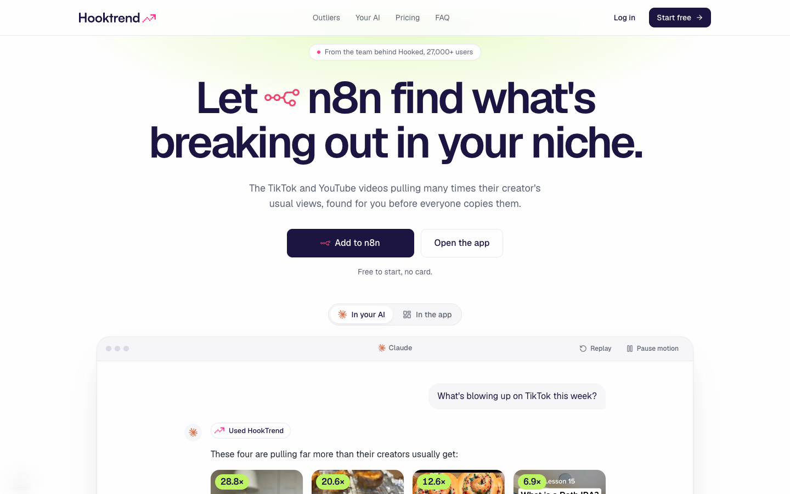
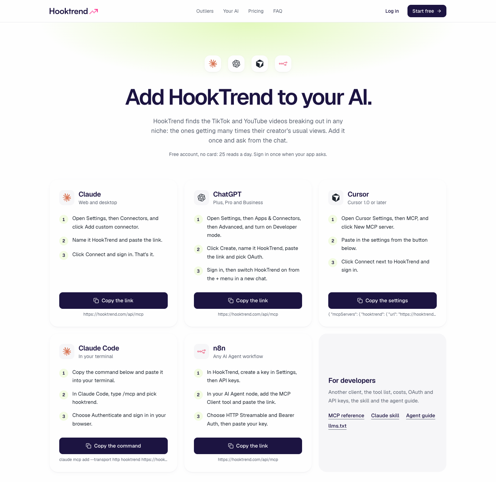
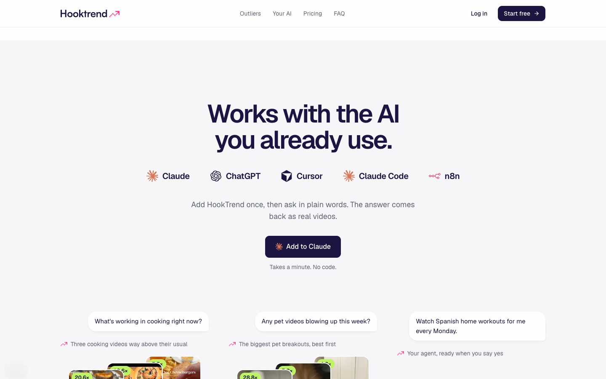
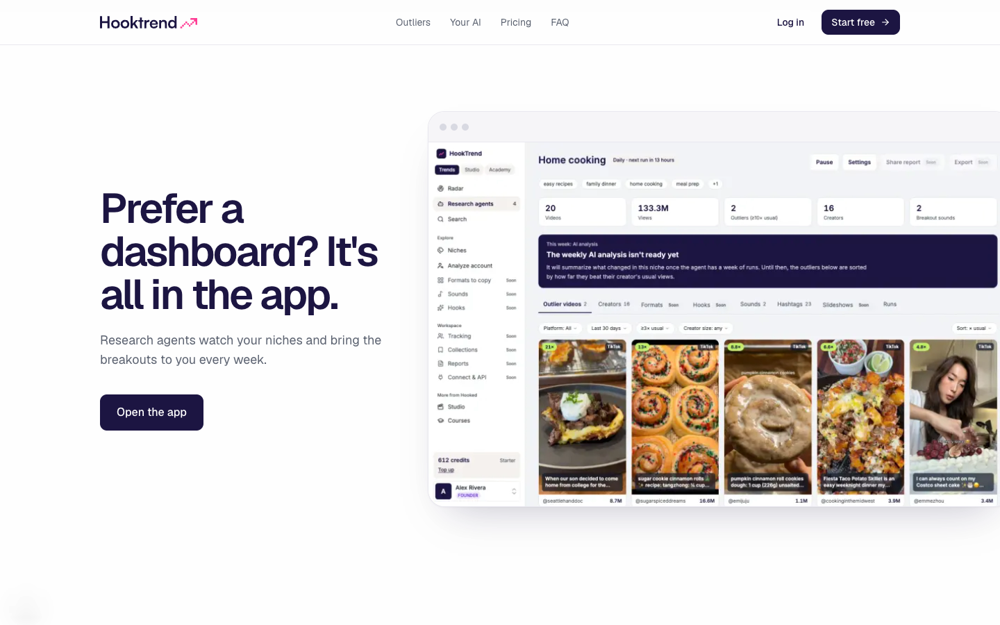

<p align="center">
  
</p>

<h1 align="center">HookTrend MCP</h1>

<p align="center">
  Let your AI find what's breaking out in your niche.<br>
  The TikTok and YouTube videos pulling many times their creator's usual views, from Claude, ChatGPT, Cursor, Claude Code or n8n.
</p>

<p align="center">
  <a href="https://hooktrend.com">hooktrend.com</a> ·
  <a href="https://hooktrend.com/mcp">Setup</a> ·
  <a href="https://hooktrend.com/docs/mcp">MCP reference</a> ·
  <a href="https://hooktrend.com/agents/guide.md">Agent guide</a> ·
  <a href="https://hooktrend.com/llms.txt">llms.txt</a>
</p>



## One URL

```
https://hooktrend.com/api/mcp
```

Remote MCP server over Streamable HTTP. Sign in with OAuth when your app asks (dynamic client registration, PKCE), or send a HookTrend API key as `Authorization: Bearer <key>`. A free account needs no card and includes 25 library reads a day.

This repository holds no server code. It packages that URL for each client: a thin skill, plugin manifests and the MCP Registry entry.

## Add it to your AI

### Claude (web and desktop)

1. Open **Settings → Connectors** and click **Add custom connector**.
2. Name it `HookTrend` and paste `https://hooktrend.com/api/mcp`.
3. Click **Connect** and sign in.

### ChatGPT (Plus, Pro and Business)

1. Open **Settings → Apps & Connectors → Advanced** and turn on **Developer mode**.
2. Click **Create**, name it `HookTrend`, paste `https://hooktrend.com/api/mcp` and pick **OAuth**.
3. Sign in, then switch HookTrend on from the **+** menu in a new chat.

### Claude Code

```sh
claude mcp add --transport http hooktrend https://hooktrend.com/api/mcp
```

Then type `/mcp`, pick `hooktrend` and choose **Authenticate**.

Or install the plugin (MCP server + skill) from this repo:

```sh
claude plugin marketplace add SaasKitchen/hooktrend-mcp
claude plugin install hooktrend@hooktrend
```

### Cursor

One click: [Add HookTrend to Cursor](cursor://anysphere.cursor-deeplink/mcp/install?name=hooktrend&config=eyJ1cmwiOiJodHRwczovL2hvb2t0cmVuZC5jb20vYXBpL21jcCJ9)

Or open **Cursor Settings → MCP → New MCP server** and paste:

```json
{
  "mcpServers": {
    "hooktrend": { "url": "https://hooktrend.com/api/mcp" }
  }
}
```

Then click **Connect** next to HookTrend and sign in. This repo is also a Cursor plugin (`.cursor-plugin/plugin.json`, `mcp.json`, `skills/`).

### Codex

```sh
codex mcp add hooktrend --url https://hooktrend.com/api/mcp
codex mcp login hooktrend
```

Or in `~/.codex/config.toml`:

```toml
[mcp_servers.hooktrend]
url = "https://hooktrend.com/api/mcp"
```

### n8n (AI Agent node)

1. In HookTrend, create a key in **Settings → API keys**.
2. In your AI Agent node, add the **MCP Client** tool and paste `https://hooktrend.com/api/mcp`.
3. Choose **HTTP Streamable** and **Bearer Auth**, then paste your key.



## Then just ask

- "What's breaking out on TikTok this week?"
- "What's working in cooking right now?"
- "Find small creators blowing up with protein breakfast videos."
- "Watch Spanish home workouts for me every Monday."
- "How many credits do I have?"

Answers come back as real videos with their **× usual** score: the video's views divided by the creator's usual views per video. A 40,000-view video from a 2,000-view account is a 20× outlier, so small creators surface next to big ones.



## Tools

| Tool | What it answers | Cost |
|---|---|---|
| `whats_breaking_out` | What's breaking out right now | Free (daily read cap) |
| `niche_outliers` | Outliers in one niche | Free (daily read cap) |
| `find_videos` | Videos on any topic, ranked by × usual | Free (daily read cap) |
| `find_creators` | Creators behind a topic's outliers | Free (daily read cap) |
| `list_niches` | Available niches | Free (daily read cap) |
| `niche_report` | Outliers, creators, sounds and hashtags of a niche | Free (daily read cap) |
| `trending_sounds` | Rising sounds and their lifecycle | Free (daily read cap) |
| `trending_hashtags` | Rising hashtags and their lifecycle | Free (daily read cap) |
| `lookup_creator` | Study a TikTok or YouTube account | Free if already analyzed; 8 credits for a fresh analysis, after your yes |
| `create_research_agent` | Research agent that watches a brief's keywords | Proposal free; 15 credits per run, after your yes |
| `list_agents` | Your research agents | Free |
| `get_agent_report` | An agent's latest report | Free |
| `get_agent_data` | An agent's videos, creators, sounds, hashtags or runs | Free |
| `show_outliers` | Outlier cards (MCP Apps widget in Claude and ChatGPT) | Free |
| `get_balance` | Plan, credits and limits | Free |
| `estimate_cost` | Cost of an action before you run it | Free |

Anything that costs credits returns a quote first and spends nothing. It only runs when the same call comes back with `user_approved: true`, after you say yes. The live list, with example calls and responses, is at [hooktrend.com/docs/mcp](https://hooktrend.com/docs/mcp).

## Prefer a dashboard?

The same research agents and library live in the app at [hooktrend.com](https://hooktrend.com).



## Pricing

| Plan | Price | Credits a month | Includes |
|---|---|---|---|
| Free | $0, no card | 50 | 1 research agent (weekly), every library tool, 25 reads a day |
| Starter | $29/month | 1,000 | Agents on any cadence, 500 reads a day, alerts, exports, fresh creator lookups |
| Pro | $99/month | 4,000 | Everything in Starter, 3 seats, reports with your brand |

Current prices: [hooktrend.com/#pricing](https://hooktrend.com/#pricing).

## What's in this repo

```
.claude-plugin/plugin.json        Claude Code plugin
.claude-plugin/marketplace.json   Claude Code marketplace (this repo)
.cursor-plugin/plugin.json        Cursor plugin
.codex-plugin/plugin.json         Codex plugin
.mcp.json                         MCP server for Claude Code and Codex
mcp.json                          MCP server for Cursor
skills/hooktrend/SKILL.md         Thin skill that routes trend questions to HookTrend
server.json                       Official MCP Registry entry
```

The skill is deliberately thin: it tells the assistant when to use HookTrend and defers everything else to the server's live instructions and [the agent guide](https://hooktrend.com/agents/guide.md). The canonical copy is served at [hooktrend.com/agents/SKILL.md](https://hooktrend.com/agents/SKILL.md) (zip: [hooktrend-skill.zip](https://hooktrend.com/agents/hooktrend-skill.zip)).

## Coverage

TikTok and YouTube. Not Instagram.

## Privacy and data

- HookTrend only receives the inputs of the tools your AI app calls (a niche, a search, a handle, a research brief). It never receives your conversation, chat history or files.
- Your AI app receives public TikTok and YouTube data with HookTrend's scores, your team's research agents and results, and your plan and credit balance. Never your email, payment details or tokens.
- Before anything that spends credits, HookTrend returns the cost to your AI app so it can ask you first.
- Disconnect an AI app at any time in HookTrend under Settings → Connected apps.

Full details: [Privacy Policy](https://hooktrend.com/privacy) · [Terms of Service](https://hooktrend.com/terms) (English and Spanish).

## Support

- Email: support@hooked.so
- Privacy: [hooktrend.com/privacy](https://hooktrend.com/privacy)
- Terms: [hooktrend.com/terms](https://hooktrend.com/terms)
- Issues with this repo: [GitHub issues](https://github.com/SaasKitchen/hooktrend-mcp/issues)

HookTrend is part of the [Hooked](https://hooked.so) suite.

## License

MIT for the files in this repository. The HookTrend service is governed by its [terms](https://hooktrend.com/terms).
